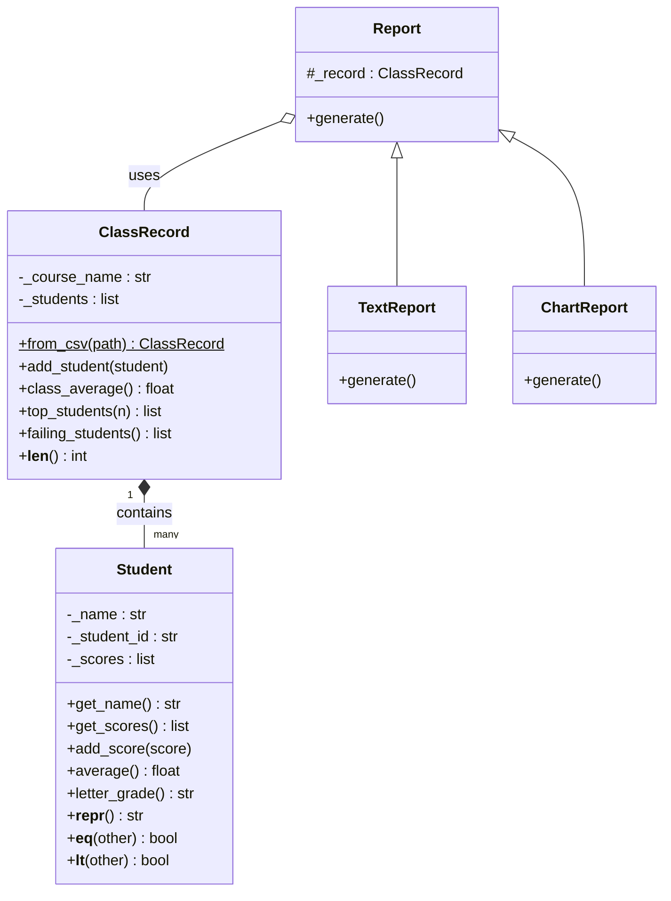

# gradeview

A simple Python library for analyzing student grades. Load a class record from a CSV file, then get averages, letter grades, top students, students below passing, and a bar chart.

Built for the DS212 Object-Oriented Programming final project (DS2B-G5).

## Installation

Coming soon on PyPI:

```bash
pip install gradeview
```

## Quick start

```python
from gradeview import ClassRecord, TextReport, ChartReport

record = ClassRecord.from_csv("sample_scores.csv", "DS212")

print(record.class_average())     # average of the whole class
print(record.top_students(3))     # the 3 highest averages
print(record.failing_students())  # students below 75

TextReport(record).generate()     # prints a summary
ChartReport(record).generate()    # draws a bar chart
```

The CSV needs a `name` column and a `student_id` column. Every other column is treated as a score from 0 to 100.

## Class diagram



## OOP concepts used

| Concept | Where |
|---|---|
| Encapsulation | `Student` and `ClassRecord` keep their data private (`_scores`, `_students`) behind getter methods |
| Inheritance | `TextReport` and `ChartReport` inherit from `Report` |
| Polymorphism | Each report overrides `generate()` in its own way |
| Dunder methods | `__repr__`, `__eq__`, `__lt__`, `__hash__`, `__len__` |
| Composition | A `ClassRecord` contains many `Student` objects |

## Contributors

DS2B-G5:

- Abragan, Ira Marie
- Añabieza, Shaira Marqueza
- Catanus, Baby Grace
- Fiola, Hopelyn Grace
- Lauzon, Angel Janelle

## License

MIT
